# Post-contenido Unidad 9: seguridad en aplicaciones web

## Descripción
Repositorio del laboratorio de la Unidad 9 de Programación Web (séptimo semestre). Contiene un único proyecto Maven Spring Boot, `seguridad-web/`, con dos mecanismos de autenticación que conviven: sesión con Spring Security (form-login) para las vistas Thymeleaf, y JWT sin estado para la API REST bajo `/api/**`. El dominio es pequeño a propósito: un `Usuario` con rol ADMIN o USER y una `Tarea` que cada usuario crea y consulta, para que la evidencia se concentre en la seguridad.

## Estructura del proyecto
```
seguridad-web/src/main/java/com/universidad/seguridad/
├── SeguridadApplication.java
├── config/       SecurityConfig.java  (las dos SecurityFilterChain)
├── security/     JwtUtil.java, JwtAuthFilter.java
├── controller/   AuthController, TareaWebController, ApiAuthController, ApiTareaController
├── service/      UsuarioService, TareaService, UsuarioDetailsService
├── repository/   UsuarioRepository, TareaRepository
└── model/        Usuario, Tarea
seguridad-web/src/main/resources/
├── application.properties
├── static/css/estilos.css
└── templates/    auth/login, auth/registro, dashboard, tareas, admin/panel
capturas/
```

## Parte 1: login con sesión, BCrypt, roles y mitigación activa
`SecurityConfig` define `webFilterChain` (`@Order(2)`, `securityMatcher("/**")`) con form-login, `BCryptPasswordEncoder(12)`, `UserDetailsService` contra MySQL y autorización por rol: `/admin/**` solo para ADMIN, y `@PreAuthorize` en los servicios. CSRF queda activo en esta cadena, porque sirve formularios con cookie de sesión. El registro guarda un hash BCrypt y asigna siempre el rol `ROLE_USER`.

### Verificación activa de XSS
El nombre de usuario se muestra con `th:text`, que escapa el contenido. Se registró un usuario con el nombre `<script>alert("XSS")</script>`:
- Con `th:text`, el navegador muestra el texto literal y no ejecuta nada (`dashboard-seguro.png`).
- Como prueba temporal se cambió esa línea a `th:utext`. El navegador interpretó el nombre como HTML y mostró la alerta (`xss-utext.png`). Después de aceptarla, el nombre desaparece de la página porque el script ocupó su lugar (`xss-utext-pagina.png`).
- El cambio se revirtió de inmediato. En el repositorio solo queda `th:text`.

### Verificación activa de SQL Injection
`TareaRepository.buscarPorTitulo` usa `@Query` con parámetros nombrados, que JPA envía como `PreparedStatement`. Con la entrada `' OR '1'='1` la búsqueda devuelve 0 tareas, porque el texto se trata como un valor y no como parte de la consulta (`sql-injection-mitigado.png`). La versión insegura queda solo como comentario en el repositorio. Con ella, la condición `OR '1'='1` siempre sería verdadera y devolvería todas las tareas de todos los usuarios, sin filtrar por título.

### Verificación de CSRF
Un `POST /logout` sin token CSRF recibe 403 Forbidden (`csrf-403.png`). El botón de cerrar sesión del dashboard sí funciona, porque Thymeleaf incluye el token en el formulario, y redirige a `/login?logout`.

## Parte 2: API REST sin estado protegida con JWT
`apiFilterChain` (`@Order(1)`, `securityMatcher("/api/**")`) es stateless (`SessionCreationPolicy.STATELESS`) y tiene CSRF desactivado únicamente en esta cadena. `POST /api/auth/login` valida las credenciales con el mismo `AuthenticationManager`, `UserDetailsService` y BCrypt de la Parte 1 y devuelve un token firmado con HMAC que expira en una hora. `JwtAuthFilter`, un `OncePerRequestFilter`, valida el token en cada petición a `/api/**` y puebla el `SecurityContext` sin consultar la base de datos. Si el token falta o es inválido, el filtro no autentica y la cadena responde 401.

## Por qué hay dos mecanismos de autenticación
Las vistas Thymeleaf sirven a un navegador que mantiene una cookie de sesión. Ese es el mecanismo adecuado para una aplicación web tradicional, y CSRF debe seguir activo, porque el navegador adjunta la cookie de forma automática, incluso en peticiones originadas por un sitio malicioso.

La API sirve a clientes sin cookies, como una app móvil, un frontend en otro dominio o un servicio de terceros. Esos clientes no pueden depender de una sesión del servidor y necesitan una credencial autocontenida en cada petición: el token JWT en el header `Authorization`. CSRF no aplica ahí, porque no hay cookie que aprovechar y un formulario de otro sitio no puede fijar ese header.

Ningún mecanismo reemplaza al otro. Cada uno cubre un tipo de cliente distinto del mismo sistema, y no se interfieren: la cookie de sesión no autentica en la API (401) y el token no abre las vistas web (redirige al login).

## Decisiones de diseño
- Dominio de dos entidades en lugar de uno grande: la unidad evalúa la seguridad, y un dominio mayor diluiría la evidencia entre más pantallas y consultas.
- `securityMatcher` explícito y `@Order` en las dos cadenas: Spring Security usa la primera cadena cuyo matcher coincide. Sin un orden declarado, una petición a `/api/**` podría caer en el form-login y responder con una redirección en lugar de un 401.
- El filtro JWT no rechaza la petición cuando el token falta o es inválido: solo se abstiene de autenticar. La decisión de aceptar o rechazar queda en `authorizeHttpRequests`, donde ya están todas las reglas de acceso, y no se duplica la lógica en dos sitios.
- La clave de JWT sale del código: `JwtUtil` la lee de `jwt.secret`, que a su vez toma la variable de entorno `JWT_SECRET`. Una clave expuesta en el repositorio permitiría a cualquiera firmar tokens válidos.
- `@Query` con parámetros nombrados en lugar de concatenar texto: el valor del usuario nunca se interpreta como parte de la consulta.

## Ajustes sobre el enunciado
Estos cambios no están en el enunciado y se hicieron al probar el código.
- `Usuario.contrasenia` lleva `@NotBlank` y `@Size(min = 8)`. Sin esa validación, el servidor aceptaba un registro con la contraseña vacía.
- `Usuario.contrasenia` lleva `@JsonIgnore`. Sin esto, `GET /api/tareas` devolvía el hash BCrypt dentro del propietario de cada tarea.
- El registro solo enlaza `nombre`, `email` y `contrasenia` (`@InitBinder`), y `UsuarioService.registrar` pone `id` en `null` y fuerza `activo` y `rol`. Sin esto, un POST con `id=1` sobrescribía la cuenta del administrador. Se comprobó que un POST con `id=1`, `rol=ROLE_ADMIN` y `activo=false` crea un usuario normal.
- `@PreAuthorize` de `TareaService` compara por el correo del usuario autenticado (`authentication.name`). La expresión del enunciado usaba `authentication.principal.id`, que falla para cualquier usuario que no sea ADMIN, porque el principal de Spring no tiene `id` y en JWT es un texto.
- La búsqueda de tareas se limita a las del usuario autenticado. Sin esto, cualquier usuario podía leer las tareas de otros.
- El enunciado no incluye las vistas de registro ni del panel de administración, ni una forma de crear y buscar tareas. Se agregaron, junto con `TareaWebController` y una hoja de estilos mínima.
- El dashboard muestra el nombre del usuario y no su correo. Con el correo, el payload de XSS puesto en el nombre nunca se veía.
- `/error` es pública. Sin esto, un `POST /logout` sin token y sin sesión recibía una redirección al login en lugar del 403.
- `SecurityConfig` expone un bean `AuthenticationManager`. Spring no lo registra por sí solo y sin él `ApiAuthController` no se puede crear.
- `apiFilterChain` responde 401 cuando falta el token. Con la configuración del enunciado respondía 403.
- `ApiTareaController` completa la parte que el enunciado deja en `null`, y devuelve 401 si el token es válido pero el usuario ya no existe.
- El correo duplicado lanza `IllegalStateException` en lugar de `RuntimeException`, para que un error de base de datos no se muestre al usuario en el formulario.
- `application.properties` toma la URL, el usuario y la contraseña de la base de datos de las variables `DB_URL`, `DB_USERNAME` y `DB_PASSWORD`. Los valores por defecto son solo para desarrollo local.
- Spring Boot es la 3.2.12, porque start.spring.io ya no ofrece ninguna 3.x.

## Pruebas realizadas
Además de los checkpoints, se probó que la API rechaza con 401 un token expirado, uno firmado con otra clave y uno sin firma (`alg: none`), y que la respuesta de la API no crea cookie de sesión. Un USER recibe 403 en `/api/admin/**`.

## Cómo compilar y ejecutar
Requisitos: JDK 17 o superior y MySQL 8.

1. Clonar el repositorio: `git clone https://github.com/julianejurado-rgb/jurado-post1-u9.git`
2. Crear la base de datos y el usuario en MySQL:
   `CREATE DATABASE seguridad_db CHARACTER SET utf8mb4 COLLATE utf8mb4_unicode_ci;`
   `CREATE USER "appuser"@"localhost" IDENTIFIED BY "apppass";`
   `GRANT ALL PRIVILEGES ON seguridad_db.* TO "appuser"@"localhost";`
3. Si MySQL usa otra URL o credenciales, definir las variables de entorno `DB_URL`, `DB_USERNAME` y `DB_PASSWORD`. En un entorno real, definir también `JWT_SECRET` con una clave de al menos 32 caracteres.
4. Ejecutar `./mvnw spring-boot:run` dentro de `seguridad-web/` (en Windows, `.\mvnw.cmd spring-boot:run`). Hibernate crea las tablas al arrancar.
5. Crear un usuario ADMIN. Generar el hash BCrypt de la contraseña (por ejemplo, con `new BCryptPasswordEncoder(12).encode("admin123")`) e insertarlo:
   `INSERT INTO usuarios (nombre, email, contrasenia, rol, activo) VALUES ("Administrador", "admin@universidad.edu", "<hash>", "ROLE_ADMIN", 1);`
   La contraseña `admin123` es solo para el laboratorio.
6. Vistas web: `http://localhost:8080/login`. API: `POST http://localhost:8080/api/auth/login` con `{"email": "...", "contrasenia": "..."}`.
7. Con el token recibido: `curl http://localhost:8080/api/tareas -H "Authorization: Bearer <token>"`

## Nota de seguridad para producción
- La clave por defecto de `jwt.secret` es solo para desarrollo. En producción debe venir de la variable de entorno `JWT_SECRET` o de un gestor de secretos.
- Los tokens no se pueden revocar antes de su expiración: un token sigue siendo válido durante una hora aunque el usuario se desactive.
- La aplicación debe servirse por HTTPS. Sin él, las cookies de sesión y los tokens viajan en claro.

## Capturas de pantalla
Sesión. Formulario de login:

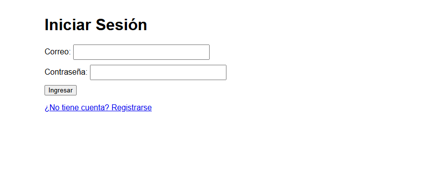

Contraseñas guardadas como hash BCrypt (`$2a$12$`) en MySQL:

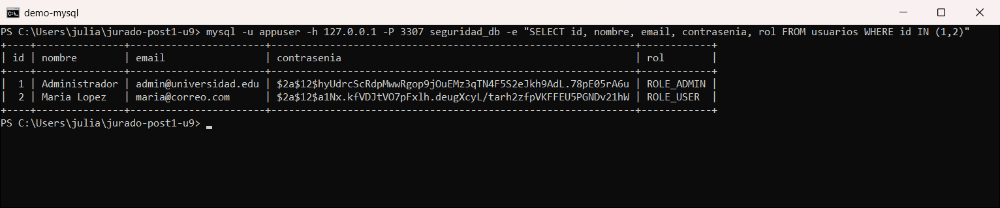

Dashboard de un ADMIN, con el enlace al panel, y panel de administración con la lista de usuarios:

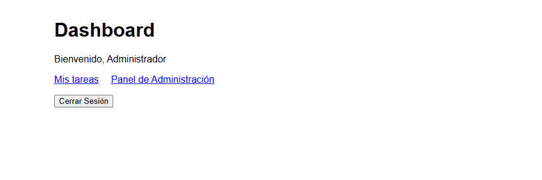

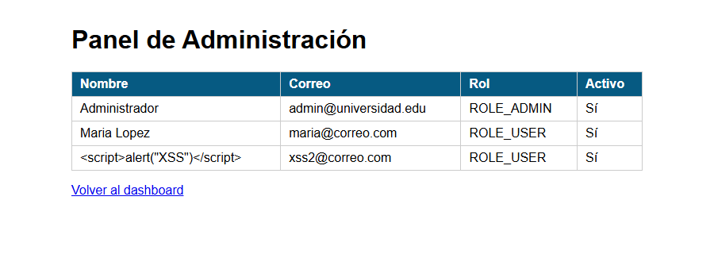

Un usuario con rol USER que pide `/admin` recibe 403:

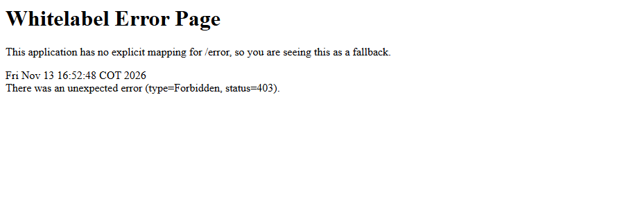

XSS. Con `th:text`, el nombre con el payload se muestra como texto:

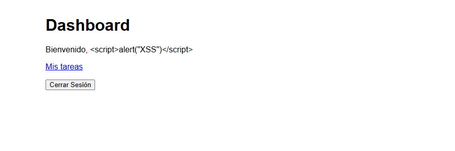

Prueba temporal con `th:utext`: el navegador ejecuta el script y muestra la alerta:

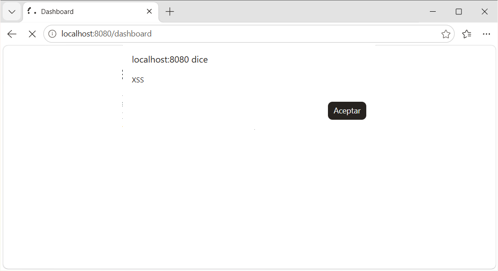

La misma prueba, una vez aceptada la alerta: el nombre desapareció de la página porque el script lo reemplazó:

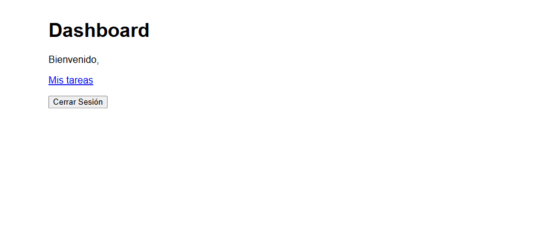

SQL Injection. Búsqueda con la entrada `' OR '1'='1`, sin resultados gracias a `@Query` parametrizado:

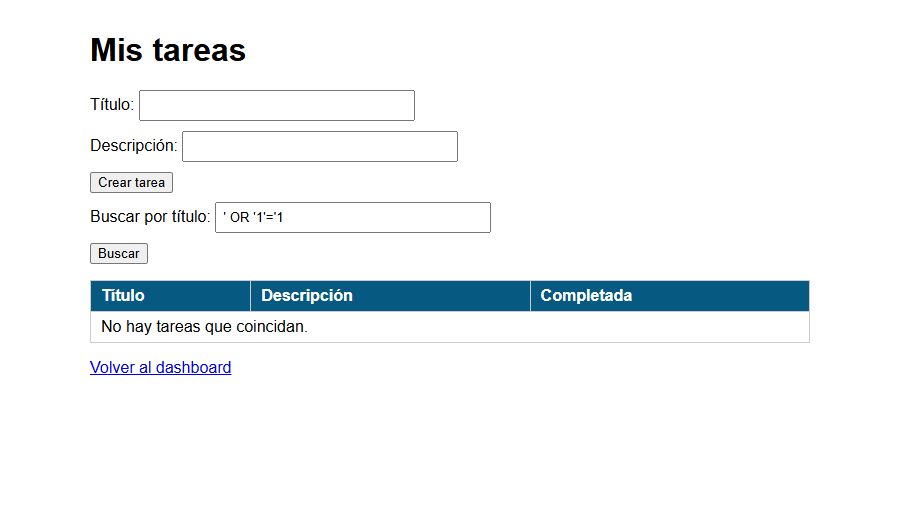

CSRF. `POST /logout` sin token, rechazado con 403:

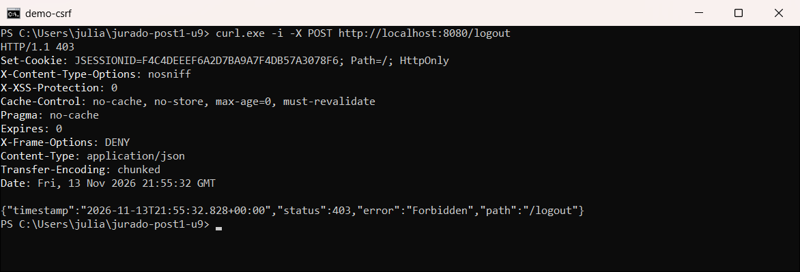

JWT. Login que devuelve el token:

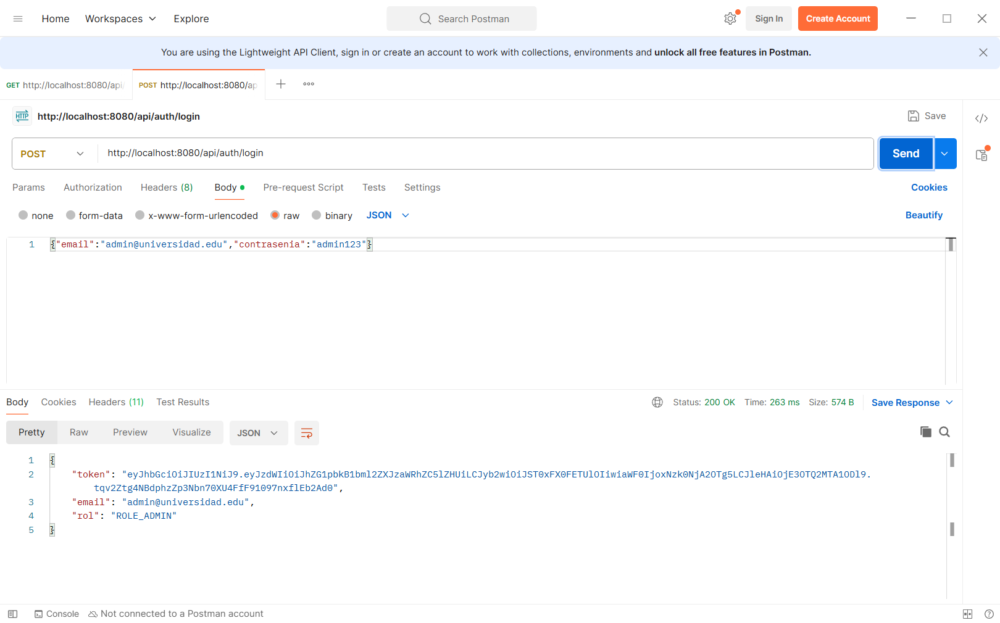

Petición a `/api/tareas` con el token en el header `Authorization`, aceptada con 200:

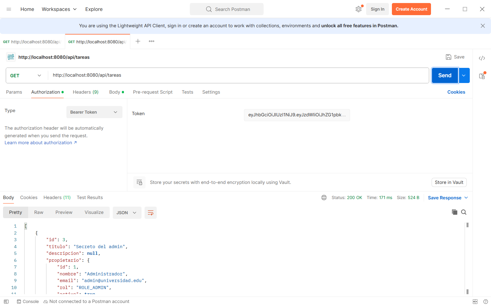

La misma petición sin token, rechazada con 401:

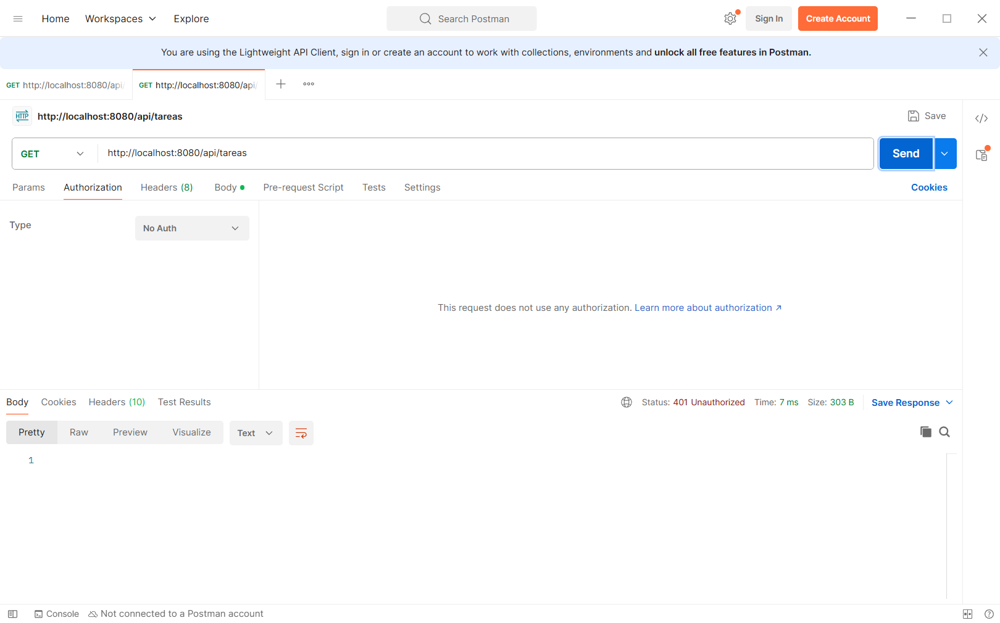
